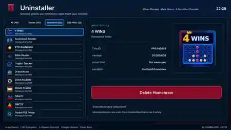

<div align="center">

# 🗑️ PS5 Uninstaller

**A native PS5 homebrew manager for removing games, homebrew and USB package files.**

[](https://github.com/Yahballon/PS5_Uninstaller/actions/workflows/build.yml)


[](https://github.com/Yahballon/PS5_Uninstaller/releases/latest)

**by YAHBALLON**



*Optimized preview of the PS5 dashboard screenshot: game / homebrew / USB PKG library, title artwork and one-click removal.*

[**Download the latest release**](https://github.com/Yahballon/PS5_Uninstaller/releases/latest) · [**Builds**](https://github.com/Yahballon/PS5_Uninstaller/actions) · [**Report an issue**](https://github.com/Yahballon/PS5_Uninstaller/issues)

</div>

---

## ✨ Features

| Feature | Description |
| --- | --- |
| 🎮 **Installed Games** | Scan and request uninstall via the native PS5 AppInstUtil service. |
| 🧩 **Homebrew** | Detect and remove supported USB homebrew folders after confirmation. |
| 📦 **USB PKGs** | Delete standalone `.pkg` archives from USB storage. Deleting a PKG archive does not uninstall an already installed game. |
| 💾 **ShadowMountPlus support** | Discover managed folder/image sources, use the official safe deletion API where available and verify background-job responses. |
| 🗂️ **USB source cleanup** | Recognize appropriately validated `/mnt/usbN/<TITLEID>-app` and `-app0` game sources, with conservative safety checks. |
| 🖼️ **Game artwork** | Load available icons and display game title, ID, version, size and location. |
| ⚡ **Fast, native UI** | English UI, DualSense controls, category tabs, async library scan and progress feedback. |
| 🛡️ **Safety-first removal** | Separate confirmation for destructive operations, source/ID validation and symlink restrictions; save-data folders are not intentionally targeted. |

## 📸 Preview


The dashboard offers four categories: **All**, **Games**, **Homebrew** and **USB PKGs**. The selected item appears in the right-hand pane with its original cover artwork, title ID, version and location.

## 📥 Installation

1. Download **`PPSA99986.zip`** from [Releases](https://github.com/Yahballon/PS5_Uninstaller/releases/latest).
2. Extract the ZIP to obtain the `PPSA99986` install folder.
3. Install/copy the native homebrew folder using a supported loader or homebrew manager on a compatible PS5.
4. Start your PS5 jailbreak environment and **elfldr on port 9021**, then launch **Uninstaller**.

> This is **native PS5 homebrew**, not an official Sony PKG. The released ZIP contains `eboot.bin`, `sce_sys`, `unscan.elf` and `unremove.elf`. A compatible homebrew-enabled PS5 is required. The project has primarily been tested in a firmware 5.10 jailbreak environment.

## 🎮 Controls

| Button | Action |
| --- | --- |
| **D-pad ↑ / ↓** | Select library item |
| **L1 / R1** | Switch categories |
| **X / Square** | Open uninstall confirmation |
| **X** | Confirm the selected action |
| **Circle** | Cancel or go back |
| **Triangle** | Refresh the game / homebrew library |

### About ShadowMount-managed games

ShadowMount may register a game whose actual contents live on USB as a folder or image. Unregistering the PS5 tile alone does **not** necessarily remove the backing source. Uninstaller inspects the source when supported and delegates managed deletion to ShadowMountPlus instead of forcing a mounted game directory to be removed.

For a **managed source**, the compatible ShadowMountPlus API can require the Uninstaller app to exit before the deletion job is permitted. The independent ELF helper records its status to disk. Always verify that a removal actually completed; an **accepted uninstall request is not proof of completion**.

## 📂 USB locations and logs

The native scanner supports the configured console / USB search roots, including standard `/mnt/usb0` … `/mnt/usb7` paths. ShadowMount game sources and USB homebrew folders are removed only if they meet the applicable validation rules.

| File | Purpose |
| --- | --- |
| `/data/Uninstaller/uninstaller.log` | General events, scans and removal results |
| `/data/Uninstaller/crash.log` | Crash diagnostics |
| `/data/Uninstaller/deferred-shadow.log` | Managed ShadowMount deletion jobs and outcomes |

Relevant log events: `SHADOWMOUNT_PREFLIGHT`, `DEFER_START`, `DEFER_WAIT`, `DEFER_QUEUED`, `DEFER_SOURCE_REMOVED`, `DEFER_FAIL`, `UNIFIED_RESULT` and `REMOVE_VERIFY_*`.

## 🛠️ Building from source

The project uses the **PS5-DevBridge** native example framework and the open-source PS5 toolchain. The GitHub Actions workflow installs the pinned dependencies, runs the host unit tests, compiles the scanner/removal ELF helpers, builds the native UI, and verifies the ZIP contents.

```text
PS5_Uninstaller/
├── .github/workflows/build.yml
├── app.json
├── assets/
│   └── make_icon.py
├── helper/
│   ├── Makefile
│   ├── unscan.c
│   └── unremove.c
├── native/
│   ├── main.cpp
│   ├── inventory.hpp
│   ├── helper_bridge.hpp
│   ├── action_bridge.hpp
│   └── shadowmount_api.hpp
├── tests/
├── screenshots/
│   └── 1.png
└── README.md
```

Use the **Actions → Build PS5 Uninstaller → Run workflow** control to trigger a test build. Successful pushes to `main` publish the versioned `PPSA99986.zip` release.

### Credits

- [PS5-DevBridge](https://github.com/Yahballon/PS5-DevBridge) — native PS5 app framework/build pipeline
- [ShadowMountPlus](https://github.com/drakmor/ShadowMountPlus) — managed source and safe storage job APIs
- PS5 homebrew/open-source tooling community

### ⚠️ Disclaimer

Use only with games and homebrew you have permission to manage. Deleting a game's physical USB source can be **permanent**. Check the displayed title and path before confirming, keep other games closed during removal, and back up anything important. No association with or endorsement by Sony Interactive Entertainment or PlayStation.

---

<div align="center"><strong>Made for the PS5 homebrew community · by YAHBALLON</strong></div>
